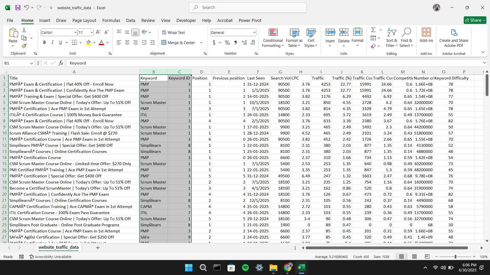
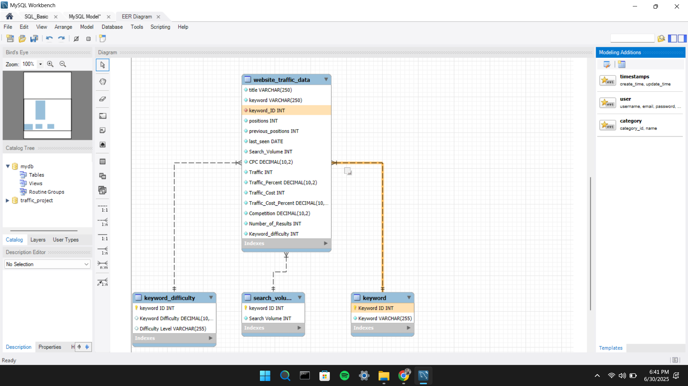
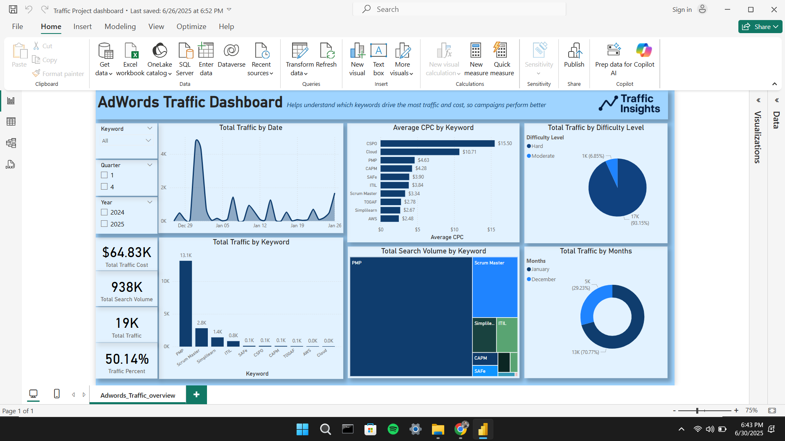
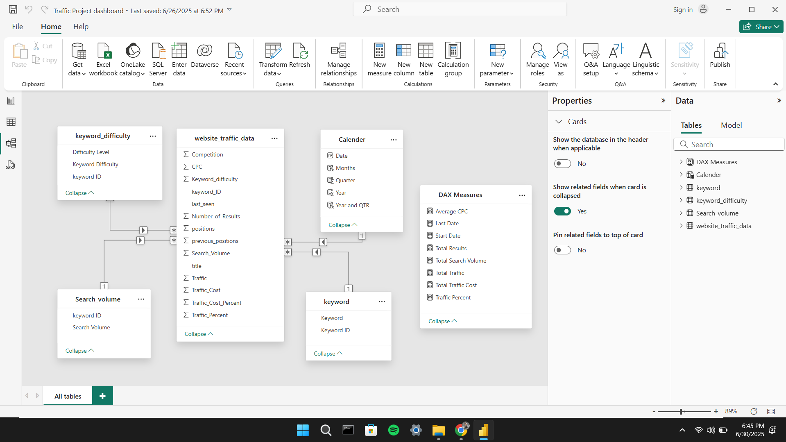

# AdPulse

Analyze ad campaign data, store it in MySQL, and visualize insights with Power BI.

## What This Project Does

- **Load**: Import raw ad data from Excel
- **Clean**: Process data with Python to remove errors and add IDs
- **Store**: Load into MySQL database with proper relationships
- **Analyze**: Run SQL queries for performance insights
- **Visualize**: Create interactive Power BI dashboards

## Tech Stack

- **Python** - Data cleaning and transformation
- **MySQL** - Relational database for storing campaign data
- **Power BI** - Dashboard and visualization
- **Excel** - Raw data input

## Project Structure

```
data/
  raw/              ← Raw Excel/CSV files
  processed/        ← Clean CSV files after Python processing
scripts/
  load_data.py      ← Load and clean data
  advanced_analytics.sql  ← SQL analysis queries
  Keyword_Script.ipynb    ← Jupyter notebook for exploration
dashboard/          ← Power BI dashboard files
```

## Quick Start

1. **Load your data**: Place ad performance data in `data/raw/`
2. **Run Python script**: `python scripts/load_data.py` to clean and process
3. **Create MySQL tables**: Use SQL scripts to build schema
4. **Build dashboard**: Import processed CSVs into Power BI

## Questions Answered

- Which keywords drive the most traffic?
- What's the cost per keyword?
- How does search volume trend over time?
- Which campaigns need optimization?
- Created unique `keyword_ID` values by mapping each keyword to a number.
- Example (conceptual):
  ```python
  df['keyword_ID'] = df['keyword'].astype('category').cat.codes
  ```

### Step 3: Splitting Clean Tables
Created three new CSVs:
- `data/processed/keyword.csv`: Unique list of keywords + IDs.
- `data/processed/search_volume.csv`: Total volume using `SUMIF`.
- `data/processed/keyword_difficulty.csv`: Average difficulty using `AVERAGEIF`.

These were calculated using Excel formulas:

| Formula | Purpose |
|---------|---------|
| `SUMIF()` | Aggregate total search volume |
| `AVERAGEIF()` | Compute average difficulty |
| `IF(B2>=50,"Hard","Moderate")` | Assign difficulty label |
| `VLOOKUP()` | Lookup keyword metadata |

These tables act as lookup/reference tables for SQL.

---

## Lookup and Fact Tables Description

### `keyword`
This table contains a deduplicated list of all unique keywords with their assigned `keyword_ID`.

| Column Name  | Description |
|--------------|-------------|
| `keyword_ID` | Unique identifier for each keyword (used as primary key) |
| `keyword`    | Actual keyword text, fetched from raw data using `VLOOKUP` |

Created using Excel's `VLOOKUP` function to map keywords with their IDs.


---

### `search_volume`
This table includes the total monthly search volume per keyword.

| Column Name     | Description |
|-----------------|-------------|
| `keyword_ID`    | Foreign key that links to the `keyword` table |
| `search_volume` | Monthly search volume, aggregated using Excel's `SUMIF` function |

Created using `SUMIF` to calculate the total search volume for each keyword ID.


---

### `keyword_difficulty`
This table stores the average keyword difficulty score along with a difficulty level label.

| Column Name       | Description |
|-------------------|-------------|
| `keyword_ID`      | Foreign key linking to the `keyword` table |
| `avg_difficulty`  | Average difficulty score, calculated using `AVERAGEIF` |
| `difficulty_level`| Text label derived using Excel's `IF` function (for example, `"Hard"` if >= 50) |

Created using:
- `AVERAGEIF` to compute average difficulty per `keyword_ID`
- `IF` to categorize as `"Hard"` or `"Moderate"`


---

### `website_traffic_data` (Main Fact Table)
This table holds all enriched campaign performance metrics after processing.

| Column Name            | Description |
|------------------------|-------------|
| `title`                | Campaign or landing page title |
| `keyword`              | Keyword string (linked via `keyword_ID`) |
| `keyword_ID`           | Foreign key from `keyword`, created using Python |
| `positions`            | Current average ad position |
| `previous_positions`   | Previous average position |
| `last_seen`            | Last recorded impression/click date |
| `Search_Volume`        | Total monthly searches |
| `CPC`                  | Cost-per-click (USD) |
| `Traffic`              | Estimated traffic from the keyword |
| `Traffic_Percent`      | Percentage of total traffic |
| `Traffic_Cost`         | Cost attributed to keyword traffic |
| `Traffic_Cost_Percent` | Percentage of total traffic cost |
| `Competition`          | Keyword competition score (0-1 scale) |
| `Number_of_Results`    | Total search engine results for the keyword |
| `Keyword_difficulty`   | Difficulty value captured in source export |

This is the central fact table, joined with lookup tables to support relational queries and visualizations.



---

## SQL Schema and Relationships

Created a MySQL database:

```sql
CREATE DATABASE IF NOT EXISTS Traffic_project;
USE Traffic_project;
```

### Main Table: `website_traffic_data`
This is the fact table containing ad performance metrics.

```sql
CREATE TABLE website_traffic_data (
    title VARCHAR(250) NOT NULL,
    keyword VARCHAR(250) NOT NULL,
    keyword_ID INT NOT NULL,
    positions INT NOT NULL,
    previous_positions INT NOT NULL,
    last_seen DATE NOT NULL,
    Search_Volume INT NOT NULL,
    CPC DECIMAL(10,2) NOT NULL,
    Traffic INT NOT NULL,
    Traffic_Percent DECIMAL(10,2) NOT NULL,
    Traffic_Cost INT NOT NULL,
    Traffic_Cost_Percent DECIMAL(10,2) NOT NULL,
    Competition DECIMAL(10,2) NOT NULL,
    Number_of_Results INT NOT NULL,
    Keyword_difficulty INT NOT NULL
);
```

### Schema Screenshot


### Keys and Normalization

Imported the other CSVs into MySQL:
- `keyword`
- `search_volume`
- `keyword_difficulty`

Then established relational integrity:

```sql
ALTER TABLE website_traffic_data
ADD FOREIGN KEY (keyword_ID) REFERENCES keyword(keyword_ID);
```

These keys ensure consistent data joins between tables.

---

## Relationship Diagram (EER)



These diagrams visualize the relationships between:
- Keywords -> Traffic Data
- Keyword Difficulty -> Traffic Data
- Search Volume -> Traffic Data

---

## Power BI Dashboard

Connected Power BI to the MySQL database and created an interactive dashboard.

### Visual Elements
- Cards: Total Traffic, Search Volume, Cost, Results
- Line Chart: Traffic over time
- Bar Chart: Traffic by Keyword
- Treemap: Search Volume by Keyword
- Pie/Donut: Traffic by Difficulty, by Month
- Slicers: Year, Quarter, Keyword filter



### DAX Measures

```DAX
Average CPC = AVERAGE(website_traffic_data[CPC])
Last Date = MAX('website_traffic_data'[last_seen])
Start Date = MIN('website_traffic_data'[last_seen])
Total Results = SUM(website_traffic_data[Number_of_Results])
Total Search Volume = SUM(website_traffic_data[Search_Volume])
Total Traffic = SUM('website_traffic_data'[Traffic])
Total Traffic Cost = SUM(website_traffic_data[Traffic_Cost])
Traffic Percent = AVERAGE(website_traffic_data[Traffic_Percent])

Calender = CALENDAR([Start Date],[Last Date])
Months = FORMAT(Calender[Date],"MMMM")
Quarter = QUARTER(Calender[Date])
Year = YEAR(Calender[Date])
Year and QTR = 'Calender'[Year] & " QTR " & 'Calender'[Quarter]
```

These measures enable filtering, aggregation, and time-based visualizations.

---

## Power BI Data Model View

To enable seamless slicing and aggregation, a clean star schema was created in Power BI.

### Relationships
- Fact: `website_traffic_data`
- Dimensions:
  - `keyword` (via `keyword_ID`)
  - `keyword_difficulty`
  - `search_volume`

This model ensures accurate filtering and joins.



---

## Advanced Analytics

The file `scripts/advanced_analytics.sql` contains 8 business-focused SQL queries that support practical optimization decisions:

1. Top 10 traffic-to-cost efficient keywords: identifies where spend converts into traffic most effectively.
2. Position improvement tracking: highlights keywords improving in rank versus previous snapshots.
3. CPC tier segmentation: compares low/medium/high CPC segments by keyword count and average traffic.
4. Monthly trend reporting: tracks total traffic, spend, and average CPC by month.
5. Missed opportunity keywords: finds above-average search volume keywords with below-average traffic.
6. Difficulty vs performance analysis: benchmarks traffic and CPC across difficulty levels.
7. Top cost drivers: surfaces top 5 expensive keywords with latest position and difficulty context.
8. Competition bucket analysis: compares low/medium/high competition bands on traffic and CPC.

These queries are designed for campaign budget planning, rank optimization, and creative prioritization with marketing stakeholders.

---

## How to Use This Project

### 1. Clone the Repo


### 2. Install Dependencies

```bash
pip install -r requirements.txt
```

### 3. Review Source Data
- Raw file: `data/raw/Raw_data.xlsx`
- Processed CSV files: `data/processed/`

### 4. Set Up MySQL and Load Data Automatically
- Update credentials in `scripts/load_data.py` (or map from your `.env` values).
- Run:

```bash
python scripts/load_data.py
```

### 5. Run Advanced SQL Analytics
- Open MySQL client and run:

```sql
SOURCE scripts/advanced_analytics.sql;
```

### 6. Open Power BI Dashboard
- File: `dashboard/Traffic Project dashboard.pbix`
- Or connect manually via: `Home -> Get Data -> MySQL`

---

## Repository Structure

```text
ad-performance-analytics/
|-- data/
|   |-- raw/
|   |   |-- Raw_data.xlsx
|   |-- processed/
|       |-- website_traffic_data.csv
|       |-- keyword.csv
|       |-- keyword_difficulty.csv
|       |-- search_volume.csv
|-- scripts/
|   |-- __init__.py
|   |-- load_data.py
|   |-- Keyword_Script.ipynb
|   |-- advanced_analytics.sql
|   |-- Traffic Data SQL script.sql
|-- dashboard/
|   |-- Traffic Project dashboard.pbix
|-- docs/
|   |-- raw_excel_sample.png
|   |-- excel_lookup_table_1.png
|   |-- excel_lookup_table_2.png
|   |-- excel_lookup_table_3.png
|   |-- main_table.png
|   |-- mysql_schema_editor.png
|   |-- EER_Diagram.png
|   |-- power_bi_dashboard.png
|   |-- powerbi_data_model.png
|-- .env.example
|-- requirements.txt
|-- README.md
```
